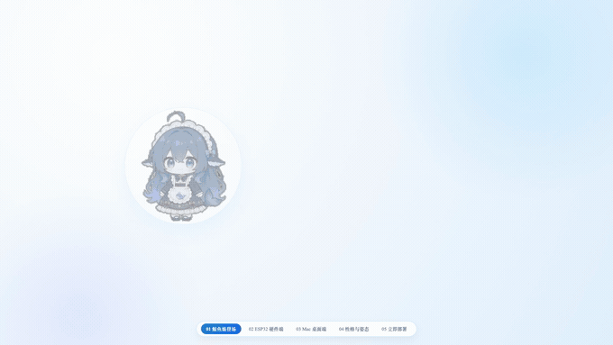
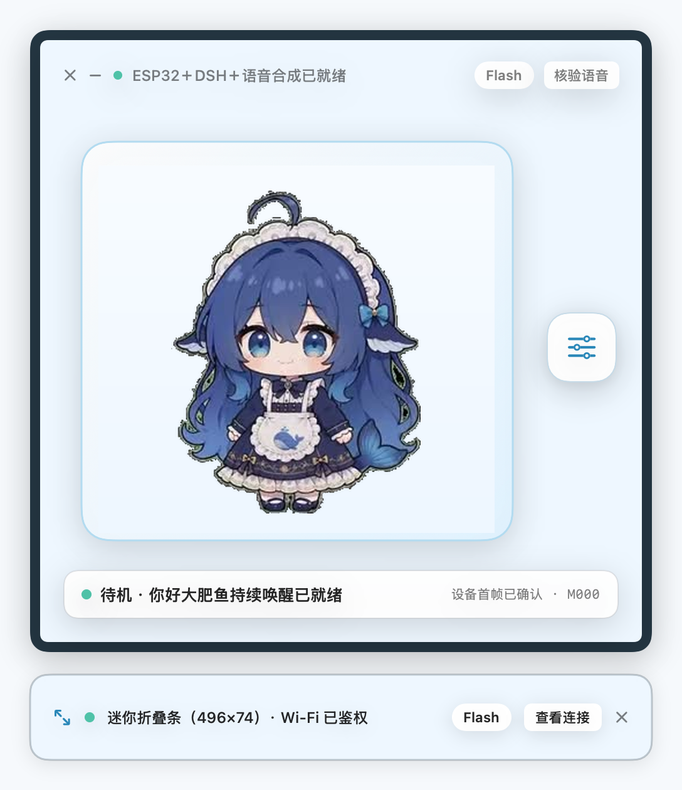
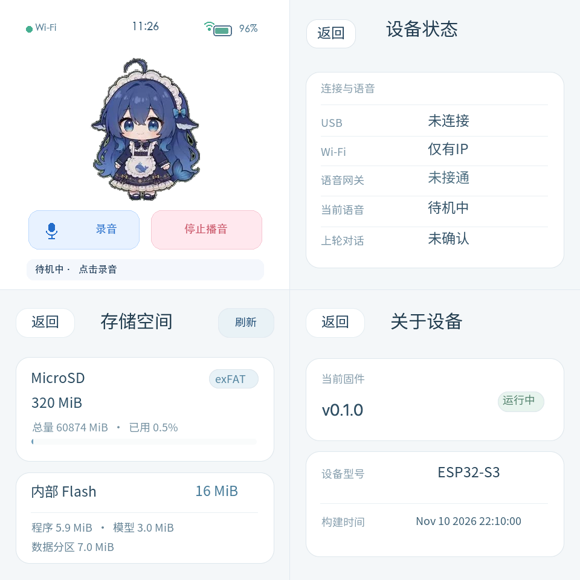
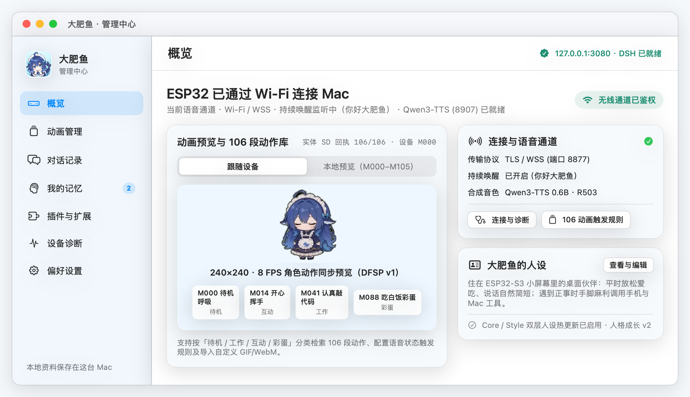
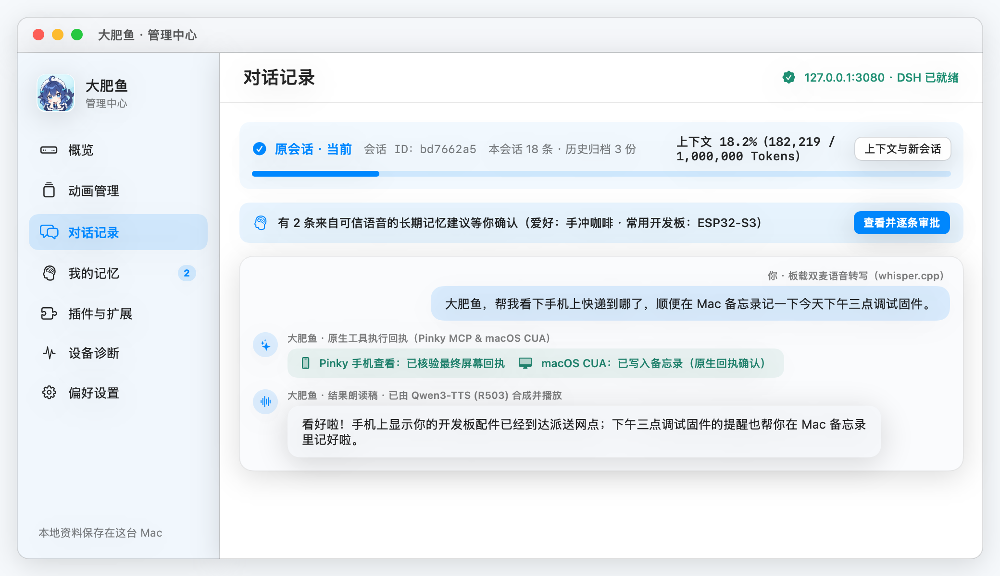
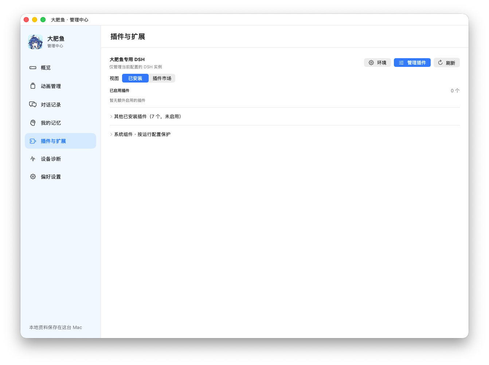
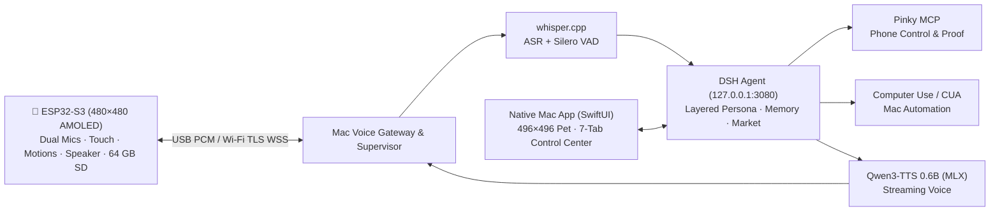

<p align="center"></p>
<h1 align="center">🐳 Dafeiyu (Whale-Girl) · Deepseek-live</h1>
<p align="center"><strong>Bring DeepSeek's beloved community "Whale-Girl (大肥鱼)" onto your desk: offline voice, expressive animations, a square macOS pet, and real phone/Mac hands</strong></p>
<p align="center">
  <a href="LICENSE"></a>
  
  
  
  
</p>
<p align="center"><a href="README.md">简体中文</a> · <strong>English</strong> · <a href="docs/AGENT_INSTALL_PROMPT.md">🤖 Agent Setup Brief</a> · <a href="docs/INSTALL_MAC.md">📖 Setup Guide</a> · <a href="docs/ARCHITECTURE.md">🏗️ Architecture</a> · <a href="docs/HARDWARE_AND_MICROSD.md">🔌 Hardware & SD</a></p>

> **Born from the viral community meme where DeepSeek's blue whale logo mistook itself for a "Big Fat Fish" (大肥鱼):** The blue-haired, ahoge-topped, whale-tailed maid now lives on a physical square AMOLED screen and as a square pet on your Mac! Call `"ni hao da fei yu"` and she perks up with lip-sync—insisting she isn't fat (blaming all those Token "rice bowls" you fed her), while still staying razor-sharp when operating your phone or Mac.

<p align="center">
  <a href="https://github.com/wendyltan/Deepseek-live-public/releases/download/v0.1.0/dafeiyu-promo-1080p.mp4">
    
  </a><br/>
  <sub>🎬 <a href="https://github.com/wendyltan/Deepseek-live-public/releases/download/v0.1.0/dafeiyu-promo-1080p.mp4">Watch / Download the Full 16:9 1080p Promo Video (MP4)</a></sub>
</p>

## ✨ Dual-Device Showcase: Whale-Girl Center Stage

<table>
  <tr>
    <th align="center" width="50%">Mac Square Desktop Pet (496×496) & Compact Bar (496×74)</th>
    <th align="center" width="50%">ESP32-S3 480×480 Square Touch Control Center (LVGL)</th>
  </tr>
  <tr>
    <td align="center"></td>
    <td align="center"></td>
  </tr>
  <tr>
    <th align="center">Management Center · Motion Stage & Layered Persona</th>
    <th align="center">Management Center · Live Chat, Context Gauge & Approvals</th>
  </tr>
  <tr>
    <td align="center"></td>
    <td align="center"></td>
  </tr>
</table>
<details><summary>🔌 Expand: Management Center "Plugins & Extensions" and Official DSH Market Handoff</summary><p align="center"></p></details>

## 💡 Core Experience & Architecture

| Pillar | How It Works |
|---|---|
| 🎙️ **On-Board Dual Mics, Local Voice** | **ESP32-S3 dual microphones only** (Mac never opens a mic); Wi-Fi wake & touch-to-talk powered locally by `whisper.cpp` + `Qwen3-TTS 0.6B (MLX)` streaming with lip-sync |
| 🐳 **Expressive Whale-Girl Animations** | SDMMC 1-bit exFAT reader for **64 GB microSD** (`/DAFEIYU/MOTIONS/*.DFS`); idle, coding, waving, and rice-eating easter eggs mirrored as GIFs on Mac |
| 📱 **Playful banter, Serious Hands** | Built-in **Pinky MCP** (voice-driven iPhone/Android actions with verified screen receipts) and **macOS Computer Use / CUA** with native approval prompts |
| 🧠 **Private Memory, Zero Creepiness** | **E1b dual-token memory vault** (voice candidates queued for your approval), **Core/Style reversible persona growth**, and **lossless context rotation** |
| 🖥️ **Compact Pet × 7-Tab Control Center** | Keep the `496×496` square pet or `496×74` bar on screen, or click once to open the `1230×860` **Management Center** (with USB LVGL pixel diagnostics) |

## 🔌 Hardware & End-to-End Architecture

| Component | Recommended Spec & Role |
|---|---|
| **ESP32-S3 Board** | **Waveshare ESP32-S3-Touch-AMOLED-2.16** (2.16" **480 × 480** square touch AMOLED, ESP32-S3R8, **16 MB Flash, 8 MB PSRAM**, ES7210 dual mics + ES8311 speaker) |
| **Storage & AI Host** | **64 GB microSD (exFAT)** for board animations; **Apple Silicon Mac (macOS 14+)** running local ASR, DSH Agent, TTS, and the SwiftUI app |



## 🚀 Quick Start: Deploy Your Desktop Dafeiyu in Minutes

> 🤖 **Prefer AI-assisted setup?** Hand the [Agent Setup Brief](docs/AGENT_INSTALL_PROMPT.md) directly to **Codex or Claude Code** to automate dependency checks, builds, and provisioning. *(Detailed guides in `docs/` are in Simplified Chinese with standard shell commands.)*

1. **Install Mac prerequisites & clone** (requires [Homebrew](https://brew.sh/))
   ```bash
   brew install git python@3.12 node pnpm
   git clone https://github.com/wendyltan/Deepseek-live-public.git && cd Deepseek-live-public
   ```
2. **Provision the isolated DSH Host (Port 3080)** (see the [Mac Host guide](docs/INSTALL_MAC.md))
   ```bash
   export DAFEIYU_HOME="$HOME/Library/Application Support/Deepseek-live/my-companion"
   python3.12 -m scripts.install_host plan --dsh-home "$DAFEIYU_HOME"
   python3.12 -m scripts.install_host prepare --dsh-home "$DAFEIYU_HOME" --python "$(command -v python3.12)" --initialize-secrets
   python3.12 -m scripts.install_host deps --dsh-home "$DAFEIYU_HOME" --network --confirm-network
   python3.12 -m scripts.install_host doctor --dsh-home "$DAFEIYU_HOME"
   ```
3. **Build & launch the native Mac pet and Management Center**
   ```bash
   zsh scripts/build_mac_app.sh check
   zsh scripts/build_mac_app.sh build "$HOME/Downloads/Dafeiyu-Source-Build.app" && open "$HOME/Downloads/Dafeiyu-Source-Build.app"
   ```
4. **Enable voice, phone/Mac tools, and ESP32 hardware**

| Module | Guide | Highlights |
|---|---|---|
| **Whisper ASR** | [INSTALL_WHISPER_CPP.md](docs/INSTALL_WHISPER_CPP.md) | Build Metal-accelerated `whisper.cpp`, `ggml-small`, and Silero VAD |
| **Qwen3-TTS** | [INSTALL_QWEN3_TTS.md](docs/INSTALL_QWEN3_TTS.md) | Install MLX Audio, download 0.6B weights, and enable the bundled voice |
| **Wi-Fi Gateway** | [INSTALL_VOICE_GATEWAY.md](docs/INSTALL_VOICE_GATEWAY.md) | Generate local TLS credentials, pair ESP32 via USB, and start WSS |
| **Pinky & CUA** | [INSTALL_PINKY_CUA.md](docs/INSTALL_PINKY_CUA.md) | Configure phone pairing, MCP proxy, and macOS Accessibility approvals |
| **ESP32 & Motions** | [INSTALL_ESP32_FIRMWARE_AND_MOTIONS.md](docs/INSTALL_ESP32_FIRMWARE_AND_MOTIONS.md) | ESP-IDF 5.5 firmware, [first boot](docs/FIRST_BOOT_ESP32.md), and [hardware/SD spec](docs/HARDWARE_AND_MICROSD.md) |

Run `python3.12 -m scripts.check_dependencies --stage all` anytime · See [Troubleshooting](docs/TROUBLESHOOTING.md) & [Plugins](docs/PLUGINS.md).

## 🗂️ Repository Layout

`app/` Native SwiftUI app & motion previews · `plugins/dsh-live-bridge/` DSH memory, persona & tool bridge · `scripts/` Setup, build, dependency & motion conversion CLIs · `release-assets/` Reference voice & motion manifests · `docs/` Setup, architecture & provenance guides

## 📜 License & Community

Project-owned code is released under the **[MIT License](LICENSE)** ([Licensing Scope](LICENSE_SCOPE.md)). Firmware embeds rebuildable geometric placeholder animations and chimes; the bundled reference voice is synthesized from licensed audio attributed to “冬冰” ([Provenance & Transcript](docs/VOICE_PROVENANCE.md)); the whale-girl animations retain their upstream CC BY-NC-SA 4.0 license and are converted locally ([Motion Register](docs/ANIMATION_RIGHTS_REGISTER.md) · [Third-Party Notices](docs/THIRD_PARTY_NOTICES.md)).

<p align="center">If Dafeiyu made you smile, drop a <strong>Star ⭐</strong> or open a <a href="CONTRIBUTING.md">PR with new motions & plugins</a>!<br/><sub><a href="SECURITY.md">Security</a> · <a href="CHANGELOG.md">Changelog</a> · <a href="docs/ARCHITECTURE.md">Architecture</a></sub></p>
