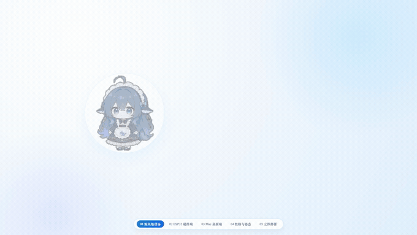
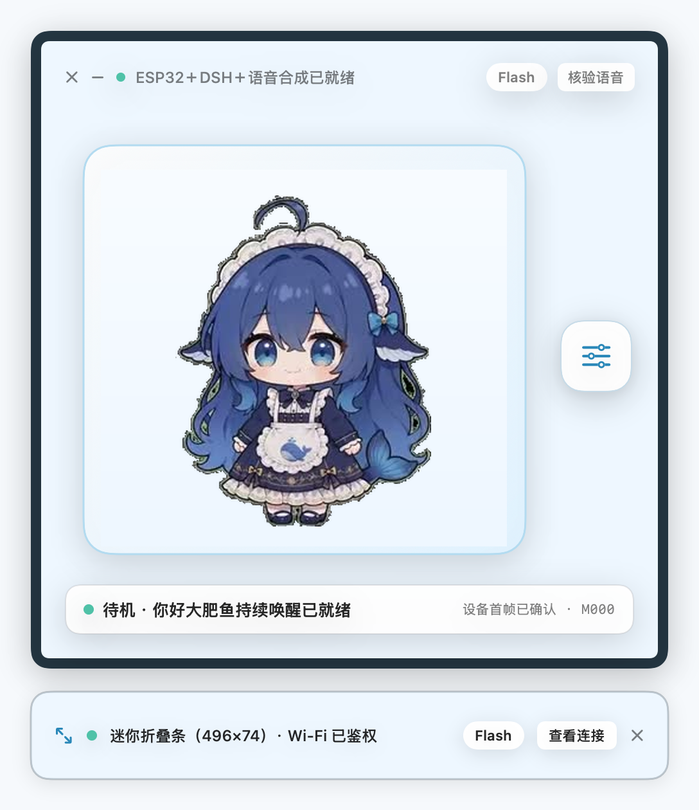
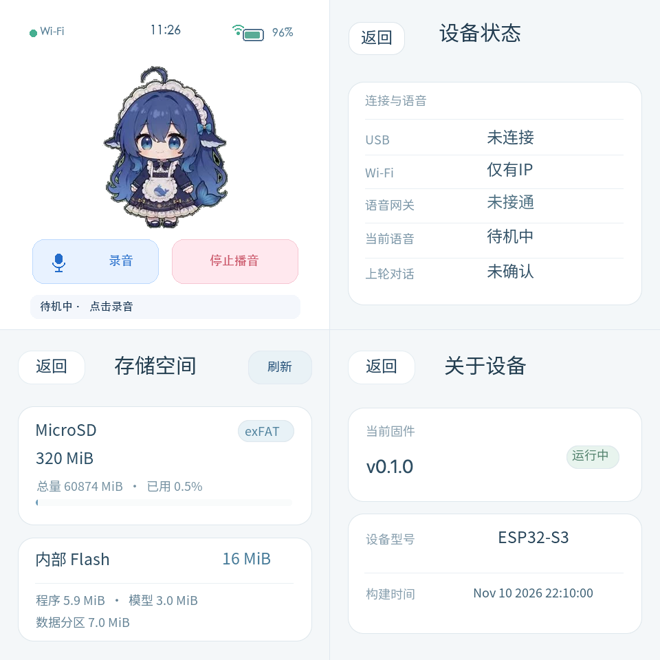
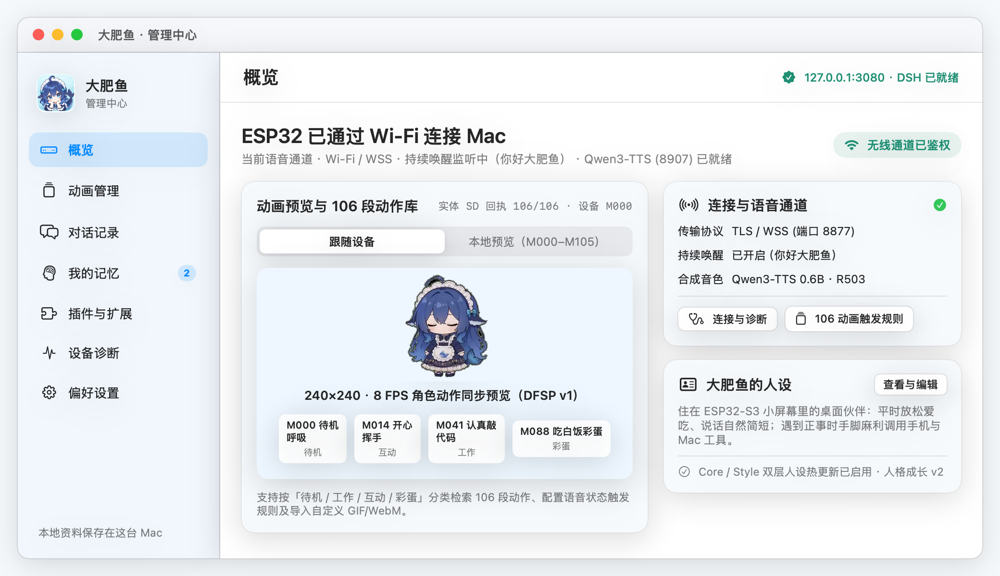
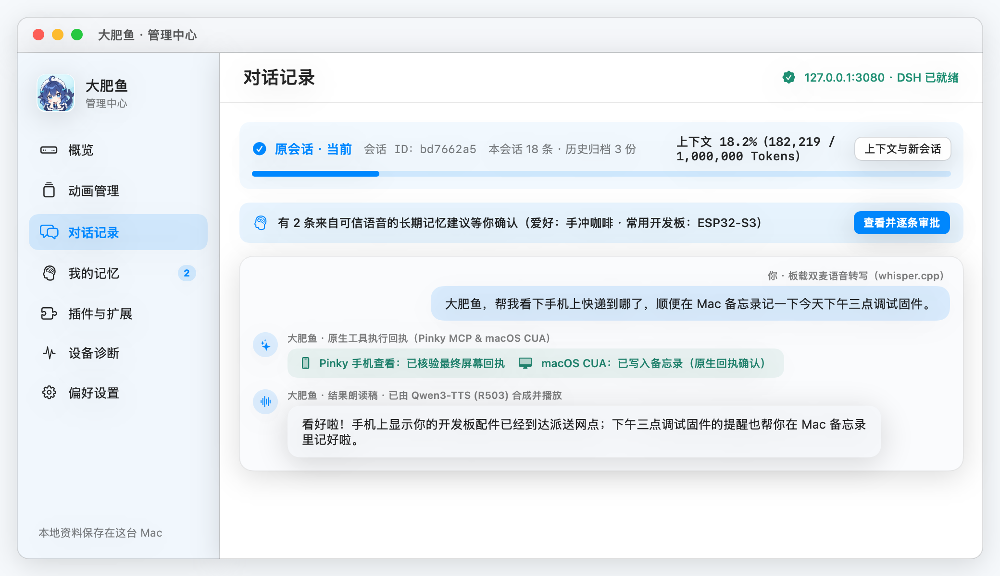
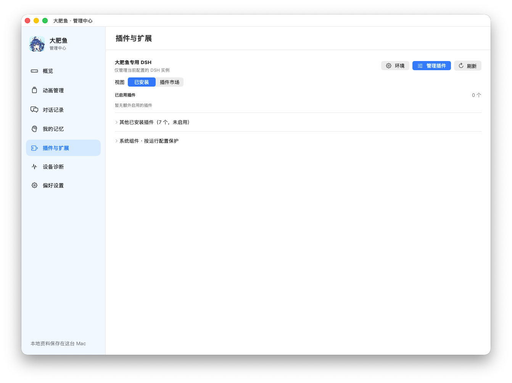
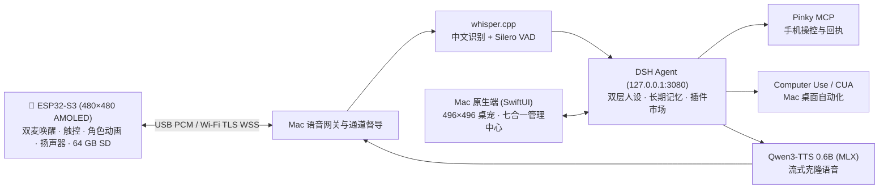

<p align="center"></p>
<h1 align="center">🐳 大肥鱼（鲸鱼娘）· Deepseek-live</h1>
<p align="center"><strong>把社区人气「鲸鱼娘」带进现实桌面的 AI 伙伴：全离线听说、丰富表情动作，还能替你操作手机与 Mac</strong></p>
<p align="center">
  <a href="LICENSE"></a>
  
  
  
  
</p>
<p align="center"><strong>简体中文</strong> · <a href="README.en.md">English</a> · <a href="docs/AGENT_INSTALL_PROMPT.md">🤖 Agent 一键部署</a> · <a href="docs/INSTALL_MAC.md">📖 安装指南</a> · <a href="docs/ARCHITECTURE.md">🏗️ 系统架构</a> · <a href="docs/HARDWARE_AND_MICROSD.md">🔌 硬件与 SD 卡</a></p>

> **当社区爆梗「蓝色大肥鱼」真正住进你的桌面：** 蓝白渐变长发、头顶呆毛、身穿女仆装的鲸鱼娘，现在拥有了实体方形 AMOLED 硬件与 Mac 四方格桌宠分身！喊一声「你好大肥鱼」，她立刻亮起双麦竖起头鳍、跟着语音口型同步陪你聊天——嘴上还嚷嚷着“我可不胖，胖也是你喂太多 Token 白米饭造成的”，真要替你点手机或操作 Mac 时却比谁都严谨靠谱。

<p align="center">
  <a href="https://github.com/wendyltan/Deepseek-live-public/releases/download/v0.1.0/dafeiyu-promo-1080p.mp4">
    
  </a><br/>
  <sub>🎬 <a href="https://github.com/wendyltan/Deepseek-live-public/releases/download/v0.1.0/dafeiyu-promo-1080p.mp4">点击下载 / 观看 16:9 完整 1080p 高清宣传短片 (MP4)</a></sub>
</p>

## ✨ 双端实机一览：大肥鱼站在你的屏幕中央

<table>
  <tr>
    <th align="center" width="50%">Mac 四方格桌宠（496×496）& 迷你折叠条（496×74）</th>
    <th align="center" width="50%">ESP32-S3 板端 480×480 方形触控中心（LVGL）</th>
  </tr>
  <tr>
    <td align="center"></td>
    <td align="center"></td>
  </tr>
  <tr>
    <th align="center">管理中心 · 角色动作预览舞台 & 双层人设卡片</th>
    <th align="center">管理中心 · 实时对话、上下文压力条 & 记忆/工具审批</th>
  </tr>
  <tr>
    <td align="center"></td>
    <td align="center"></td>
  </tr>
</table>
<details><summary>🔌 展开查看：Mac 管理中心「插件与扩展」及 DSH 官方市场接入界面</summary><p align="center"></p></details>

## 💡 核心体验与技术亮点

| 体验维度 | 实现方式 |
|---|---|
| 🎙️ **只用板端双麦，全离线听说** | **ESP32-S3 唯一板载双麦拾音**（Mac 零麦克风采集）；支持「你好大肥鱼」Wi-Fi 唤醒与触控录音，本地 `whisper.cpp` 转写 + `Qwen3-TTS 0.6B (MLX)` 流式克隆语音与口型包络同步 |
| 🐳 **丰富鲸鱼娘表情，双端同步互动** | 板端 SDMMC 1-bit 读取 **64 GB exFAT microSD**（`/DAFEIYU/MOTIONS/*.DFS`）；涵盖待机、挥手、认真敲代码、吃白米饭彩蛋等全套角色动作，Mac 端同步播放 GIF 并支持触发编排 |
| 📱 **嘴上摸鱼，手脚却能替你干活** | 深度集成 **Pinky MCP**（语音操控 iPhone/Android 并核验最终屏幕回执）与 **macOS Computer Use / CUA**（敏感动作原生弹窗审批，安全可控） |
| 🧠 **记得住偏好，记忆完全由你做主** | **E1b 双密钥长期记忆库**（自动提炼记忆候选 → 由你逐条拍板入库）、**Core/Style 双层可回滚人格成长**、**原生 Token 压力监测与无损归档开新会话** |
| 🖥️ **四方格桌宠 × 七合一管理中心** | 平时缩成桌面四方格或迷你条陪伴；轻点右侧按钮即刻展开 `1230×860` **管理中心**（概览 / 动画 / 对话 / 记忆 / 插件 / 设备诊断 / 偏好设置 & USB 屏幕诊断） |

## 🔌 硬件清单与系统全链路

| 硬件 / 节点 | 推荐配置与职责 |
|---|---|
| **ESP32-S3 开发板** | **Waveshare ESP32-S3-Touch-AMOLED-2.16**（2.16 寸 **480 × 480** 方形触控 AMOLED、ESP32-S3R8、**16 MB Flash、8 MB PSRAM**、ES7210 双麦 + ES8311 扬声器） |
| **外置存储与主机** | **64 GB microSD（exFAT）** 存放板端角色动画；**Apple Silicon Mac（macOS 14+）** 本地运行 ASR、DSH Agent、TTS 与原生管理中心 |



## 🚀 3 分钟部署你的桌面大肥鱼

> 🤖 **懒人专属（推荐）：** 直接把 [Agent 一键部署任务书](docs/AGENT_INSTALL_PROMPT.md) 交给 **Codex / Claude Code** 等 Coding Agent，它会自动完成环境体检、编译与配置。

1. **准备 Mac 基础环境并克隆仓库**（需先安装 [Homebrew](https://brew.sh/)）
   ```bash
   brew install git python@3.12 node pnpm
   git clone https://github.com/wendyltan/Deepseek-live-public.git && cd Deepseek-live-public
   ```
2. **初始化独立 DSH Host（端口 3080）**（详见 [Mac 安装指南](docs/INSTALL_MAC.md)）
   ```bash
   export DAFEIYU_HOME="$HOME/Library/Application Support/Deepseek-live/my-companion"
   python3.12 -m scripts.install_host plan --dsh-home "$DAFEIYU_HOME"
   python3.12 -m scripts.install_host prepare --dsh-home "$DAFEIYU_HOME" --python "$(command -v python3.12)" --initialize-secrets
   python3.12 -m scripts.install_host deps --dsh-home "$DAFEIYU_HOME" --network --confirm-network
   python3.12 -m scripts.install_host doctor --dsh-home "$DAFEIYU_HOME"
   ```
3. **编译并启动 Mac 桌宠与管理中心**
   ```bash
   zsh scripts/build_mac_app.sh check
   zsh scripts/build_mac_app.sh build "$HOME/Downloads/大肥鱼-源码构建.app" && open "$HOME/Downloads/大肥鱼-源码构建.app"
   ```
4. **按需接入完整语音、手机/Mac 操控与 ESP32 硬件端**

| 进阶模块 | 对应教程 | 说明 |
|---|---|---|
| **Whisper 本地识别** | [INSTALL_WHISPER_CPP.md](docs/INSTALL_WHISPER_CPP.md) | 编译 Metal 加速 `whisper.cpp`、配置 `ggml-small` 与 Silero VAD |
| **Qwen3-TTS 克隆语音** | [INSTALL_QWEN3_TTS.md](docs/INSTALL_QWEN3_TTS.md) | 安装 MLX Audio、拉取 0.6B 权重与启用随附参考音色 |
| **Wi-Fi 语音网关** | [INSTALL_VOICE_GATEWAY.md](docs/INSTALL_VOICE_GATEWAY.md) | 生成本机 TLS 凭证、USB 配对 ESP32 并启动 WSS 网关 |
| **Pinky 与 Mac CUA** | [INSTALL_PINKY_CUA.md](docs/INSTALL_PINKY_CUA.md) | 配置手机配对、MCP 代理与 macOS 辅助功能审批 |
| **ESP32 固件与动画库** | [INSTALL_ESP32_FIRMWARE_AND_MOTIONS.md](docs/INSTALL_ESP32_FIRMWARE_AND_MOTIONS.md) | ESP-IDF 5.5 编译烧录、[首次上手](docs/FIRST_BOOT_ESP32.md) 与 [硬件/SD 卡规范](docs/HARDWARE_AND_MICROSD.md) |

随时运行依赖体检：`python3.12 -m scripts.check_dependencies --stage all` · 遇到问题可先查阅 [故障排查](docs/TROUBLESHOOTING.md) 与 [插件说明](docs/PLUGINS.md)。

## 🗂️ 仓库结构速览

`app/` Mac SwiftUI 双形态应用与动作预览 · `plugins/dsh-live-bridge/` DSH 记忆/人设/工具桥接插件 · `scripts/` 一键部署/构建/依赖与动画转换脚本 · `release-assets/` 随附参考音色与动画清单 · `docs/` 全套安装、架构与权属文档

## 📜 开源许可与社区致谢

自有源码采用 **[MIT License](LICENSE)**（详见 [许可范围](LICENSE_SCOPE.md)）。固件内含可重建的原创几何提示动画与合成提示音；随附默认参考声线由作者基于已获授权的“冬冰”声线二次合成（见 [声源来源与逐字稿](docs/VOICE_PROVENANCE.md)）；鲸鱼娘角色动画遵循其上游 CC BY-NC-SA 4.0 协议并由本地脚本转换生成（见 [动画权属台账](docs/ANIMATION_RIGHTS_REGISTER.md) 与 [第三方声明](docs/THIRD_PARTY_NOTICES.md)）。

<p align="center">欢迎喜欢大肥鱼的朋友点亮 <strong>Star ⭐</strong>、提交 <a href="CONTRIBUTING.md">PR / 新动作与插件</a>，一起完善这个有趣的桌面伙伴！<br/><sub><a href="SECURITY.md">安全策略</a> · <a href="CHANGELOG.md">更新记录</a> · <a href="docs/ARCHITECTURE.md">架构细节</a></sub></p>
