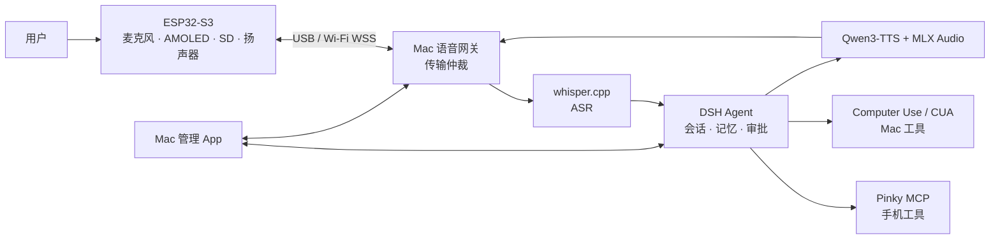

# 大肥鱼系统架构

大肥鱼由 ESP32-S3 实体终端、Mac 语音网关、DSH Agent、本地语音模型和 Mac 管理 App 构成。ESP32 负责音频输入输出、触控、角色动画；Mac 负责识别、合成、会话、记忆与工具调用。

## 运行拓扑

## 组件与职责

| 组件 | 职责 | 相关目录 |
|---|---|---|
| ESP32-S3 | 唤醒、触控、录放音、动画播放、microSD 读取 | `firmware/esp32/unified-wifi-wake/` |
| Mac 语音网关 | 接收板麦数据、协调 USB/Wi-Fi、向设备回传音频与状态 | `app/` |
| Whisper | 使用多语言 small 模型完成本地语音转写 | [安装指南](INSTALL_WHISPER_CPP.md) |
| DSH / Live Bridge | Agent 会话、任务、工具回执、记忆建议与审批 | `plugins/dsh-live-bridge/` |
| Qwen3-TTS | 结合参考音色生成中文流式语音 | [安装指南](INSTALL_QWEN3_TTS.md) |
| Pinky | 连接 iPhone/Android，通过 MCP 执行手机工具 | [安装指南](INSTALL_PINKY_CUA.md) |
| Computer Use / CUA | 通过 macOS 原生权限执行桌面任务 | [安装指南](INSTALL_PINKY_CUA.md) |
| Mac 管理 App | 会话、设备、动作、插件、记忆及诊断页面 | `native/macos/CompanionMini/` |

## 音频和任务链路

1. **拾音与转写**：ESP32 的双麦克风采集声音，经当前 USB 或 Wi-Fi 通道送到 Mac，Whisper 将录音转成文字。
2. **Agent 处理**：DSH 保持会话上下文；需要手机或电脑操作时，通过相应工具与审批流程执行。
3. **结果反馈**：Live Bridge 汇总真实工具返回，Qwen3-TTS 生成流式语音，网关将音频发送回 ESP32。
4. **状态与动画**：ESP32 显示唤醒、思考、说话和动作状态；卡内动画按固件资源映射播放。
5. **长期记忆**：通过审批界面保存记忆建议，并与会话记录分别管理。

## 运行约定

- **传输**：同一时刻由 USB 或 Wi-Fi 的一个通道负责实体语音请求，避免重复识别与重复任务。
- **本地服务**：DSH 默认 Web 端口为 `3080`；Wi-Fi 网关使用 `8877`，语音合成端口在 [TTS 指南](INSTALL_QWEN3_TTS.md)配置。
- **声音与素材**：Whisper 和 TTS 的模型在 Mac 上运行；ESP32 microSD 提供动画和其他媒体。参考声源可从 `release-assets/voice/` 选择。
- **扩展工具**：Pinky 与 Computer Use / CUA 按各自的官方机制连接与授权，工具执行以真实结果为准。

[Mac 安装与 App 构建](INSTALL_MAC.md) · [Wi-Fi 网关与配对](INSTALL_VOICE_GATEWAY.md) · [ESP32 硬件及 SD](HARDWARE_AND_MICROSD.md) · [插件与扩展](PLUGINS.md)
