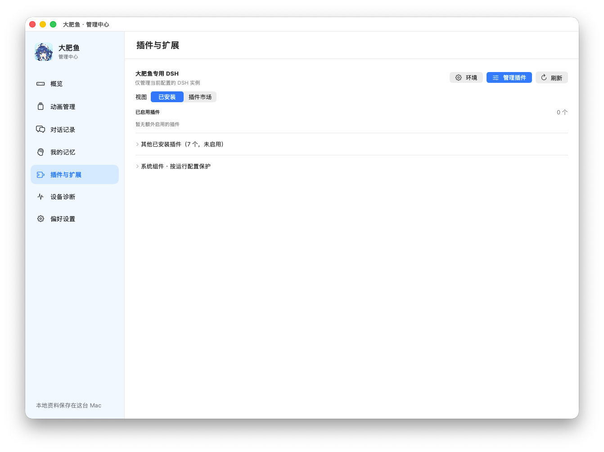

# 插件与扩展

大肥鱼使用 DSH 管理 Agent 插件，通过 Pinky MCP 调用手机工具，通过 Computer Use / CUA 使用 Mac 桌面工具。

[返回 README](../README.md) · [Mac 安装](INSTALL_MAC.md) · [Pinky / CUA 安装](INSTALL_PINKY_CUA.md)

## 核心组件

| 组件 | 用途 |
|---|---|
| `@deepseek-ai/dsh-base` | DSH Agent 基础能力 |
| `@deepseek-ai/dsh-web-app` | Web 对话与管理界面 |
| `dsh-live-bridge` | 大肥鱼人格、记忆与工具反馈 |
| Pinky MCP | iPhone / Android 手机工具 |
| Computer Use / macOS CUA | Mac 桌面识别与交互 |

这些组件由 [Mac Host 安装工具](INSTALL_MAC.md) 使用锁定版本配置。

## 管理插件

Mac 管理 App 打开 **插件与扩展** 页面后，可以查看已安装、已启用的插件及市场列表。

需要安装、启用、停用或卸载时，点击页面右上方的 **管理插件**，进入 DSH 官方插件管理界面。插件状态由官方 DSH 回执决定，返回 Mac App 后刷新列表即可查看结果。

插件管理界面截图

## 添加第三方插件

1. 在官方 DSH 插件管理页面选择发现来源或明确的软件包。
2. 查看包名、版本、依赖和权限。
3. 按页面提示完成安装与启用。
4. 返回 Mac App 刷新插件状态。
5. 通过实际工具调用验证插件功能。

插件的“已安装”和“已启用”是独立状态；设备端动画和音频资源也与 DSH npm 插件分别管理。

[DSH 官方插件管理资料](https://github.com/deepseek-ai/deepseek-harness/blob/master/packages/boot/plugin-manager/README.md)
